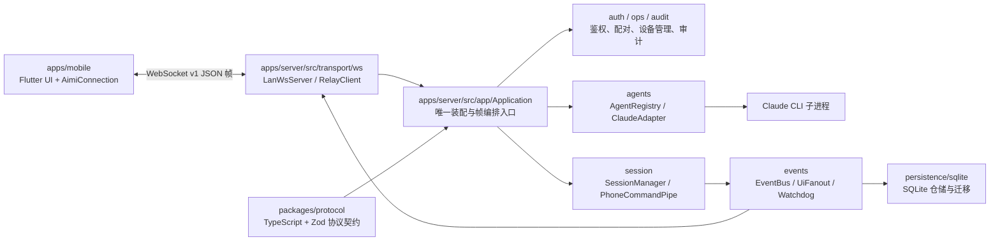

# Aimi 开发指南

## 1. 项目概述

Aimi 是一个由 Flutter 移动端、Node.js/TypeScript 服务端和协议包组成的远程 agent 会话监控与控制项目。
服务端在本机托管 agent CLI 子进程，负责会话生命周期、事件归一化、鉴权、持久化和 WebSocket 推送。
移动端通过 WebSocket 查看会话时间线并发送建会话、消息和中断命令。
技术栈为 Node.js 22、TypeScript、pnpm workspace、Zod、Vitest、SQLite、Flutter/Dart 和 Riverpod。
当前仓库包含 `apps/server`、`packages/protocol` 与 `apps/mobile`；未发现独立的 `apps/relay` 实现。

## 2. 项目架构



- `apps/server/src/app/Application` 是组合根和会话协议编排点：启动时装配 SQLite 仓储、鉴权、agent、事件总线、会话管理器和 WebSocket；关闭时按逆序释放资源。
- `transport/ws` 只负责 WebSocket 接入/中继连接和原始帧搬运；业务帧由 `Application` 解析后分派到 `auth`、`session` 或 `ops`。
- `session/SessionManager` 管理会话状态、命令入口、启动恢复和进程台账；`PhoneCommandPipe` 处理手机命令去重及投递。
- `agents/AgentRegistry` 选择适配器；`ClaudeAdapter`/`ClaudeSession` 通过 Node `child_process.spawn` 管理 Claude CLI 子进程，并把输出归一为 agent 事件。
- `events/EventBus` 为事件序号和发布顺序的中心；持久化订阅写入 SQLite，`UiFanout` 将事件推给已鉴权的连接，`SessionWatchdog` 只做停滞观测。
- `packages/protocol` 提供服务端使用的 TypeScript 类型、帧解析和 Zod 校验；移动端当前在 `apps/mobile/lib/data/protocol/frame_dto.dart` 维护对应 Dart DTO，修改协议时必须同步核对两侧。
- 服务端是单个 Node 进程、单事件循环和异步 I/O；每个 agent 会话还会产生受服务端生命周期管理的子进程。`aimi-server pair/status/devices/revoke` 是独立 CLI 进程，通过 SQLite 与运行中的服务共享状态。
- 默认只监听 loopback 明文 WS；配置非 loopback `host` 时必须同时配置 `tls.certFile`/`tls.keyFile`，服务端原生提供 WSS。WebSocket 入站有 8 MiB 单帧上限、握手缓冲上限和每连接速率限制，慢消费者超过出站缓冲上限会断开并依靠重连重放恢复。
- `ServerConfig.relay` 存在时，服务端主动建立 relay WebSocket；relay 连接与 LAN 连接共用 `Application.attachConnection` 编排入口。

## 3. 目录说明

| 路径 | 用途 |
| --- | --- |
| `apps/server/src/bin` | `aimi-server` CLI 入口和子命令绑定。 |
| `apps/server/src/app` | `Application` 组合根、配置加载和版本信息。 |
| `apps/server/src/transport` | LAN WebSocket、relay 客户端和消息管道。 |
| `apps/server/src/session` | 会话状态机、命令分发、看门狗、进程回收。 |
| `apps/server/src/agents` | agent 注册表、Claude 协议适配、审批闸和子进程会话。 |
| `apps/server/src/events` | 事件总线、UI 扇出和事件洪水控制。 |
| `apps/server/src/auth`, `ops`, `audit`, `logging` | 鉴权/配对、运维命令、审计和日志。 |
| `apps/server/src/persistence` | 内存仓储、SQLite 仓储、迁移和 schema。 |
| `apps/server/__tests__` | 服务端端到端测试；`src/**/*.test.ts` 是模块测试。 |
| `packages/protocol/src` | 服务端共享协议模型、Zod schema 和协议测试。 |
| `apps/mobile/lib` | Flutter 应用：`app` 装配、`data` 连接/协议/缓存、`domain` 视图模型、`ui` 页面。 |
| `apps/mobile/test` | Flutter 单元、组件和 smoke 测试。 |
| `docs` | 注释规范、研究资料及 superpowers 过程文件；规格和计划不作为实现依据自动替代代码。 |
| `tools` | 仓库检查脚本；当前包含 `check-deps.mjs`。 |
| `resources` | 静态资源（当前为 icon PNG）。 |
| `prototypes` | UI 原型，不属于生产应用源代码。 |
| `node_modules/`, `dist/`, `apps/mobile/build/`, `apps/mobile/.dart_tool/`, `apps/server/data/` | 依赖、编译物、Flutter 生成物和本地运行数据；均不应手动修改或提交。 |

## 4. 文档指引

- [`docs/code-comment-guidelines.md`](docs/code-comment-guidelines.md)：TypeScript 注释的职责边界、JSDoc 和提交前自检。
- [`apps/mobile/README.md`](apps/mobile/README.md)：Flutter 工程的基础入口和官方开发资源；内容较为通用。
- TODO: 待确认：当前未发现独立的服务端架构说明、协议运维手册或排障手册；`docs/superpowers/specs` 与 `docs/superpowers/plans` 属于规格/计划，按要求不列入本节。

## 5. 常用命令

前置条件：Node.js `>=22`，pnpm `9.12.0`；移动端命令需要已安装 Flutter（CI 使用 Flutter `3.41.2`）。命令均从仓库根目录执行。

```powershell
# 安装依赖（严格使用锁文件）
pnpm install --frozen-lockfile

# 依赖方向静态检查
node tools/check-deps.mjs

# TypeScript 类型检查（protocol 与 server workspace）
pnpm typecheck

# 全部 pnpm workspace 测试（protocol + server）
pnpm -r test

# 根脚本定义的 server 测试快捷方式
pnpm test

# server 构建到 apps/server/dist
pnpm --filter @aimi/server build

# server 开发模式（tsx watch；启动默认服务）
pnpm serve

# 运行单个 server 测试文件
pnpm --filter @aimi/server exec vitest run src/app/application.test.ts

# 运行单个 protocol 测试文件
pnpm --filter @aimi/protocol exec vitest run src/__tests__/schema.test.ts

# server CLI 子命令；可追加 --config <path>
pnpm --filter @aimi/server exec tsx src/bin/aimi-server.ts status
pnpm --filter @aimi/server exec tsx src/bin/aimi-server.ts pair
pnpm --filter @aimi/server exec tsx src/bin/aimi-server.ts devices
pnpm --filter @aimi/server exec tsx src/bin/aimi-server.ts revoke DEVICE_ID

# Flutter 依赖、静态分析和全量测试（从 apps/mobile 工程目录执行）
Push-Location apps/mobile
flutter pub get
flutter analyze
flutter test
Pop-Location

# Flutter 单个测试文件
Push-Location apps/mobile
flutter test test/data/connection/aimi_connection_test.dart
Pop-Location
```

- `pnpm serve`、`start`、`pair` 等会创建/读取本地数据目录和令牌；不要把生成的 `apps/server/data` 或日志提交。
- TODO: 待确认：仓库没有根级 lint/format 脚本，也没有 CI 中的移动端 APK/IPA 构建命令；提交前只执行已配置的检查，除非补充脚本后再登记构建命令。

## 6. 编码规范

1. 新增的类和函数（包括构造函数、私有方法和测试方法）必须带有清晰的注释，说明职责、行为和必要约束。正例：说明 `SessionManager` 的状态恢复约束；反例：只重复 `start()` 的函数名。
2. 函数体内的行内注释仅在行为不直观、涉及线程边界、协议兼容或资源生命周期时添加，注释说明原因和约束，不重复代码本身的含义。
3. 不允许把代码块压缩到同一行，每行只执行一件事，禁止在同一行连续写多条语句或使用单行复合语句。
4. 保持公共协议、序列化字段、数据链路命令、配置键和本地化键的向后兼容，变更前必须搜索全部调用方、生产者和消费者；尤其要同步核对 `packages/protocol/src` 与 `apps/mobile/lib/data/protocol/frame_dto.dart`。
5. 不要在源码、日志或文档中写入密钥、令牌、服务密码、生产地址或用户数据，配置读取遵循项目已有的配置对象和部署机制。
6. 优先复用已有的工具函数和公共组件，禁止重复实现同等功能，新增通用能力前先搜索现有实现。
7. TypeScript 注释使用简体中文，并遵守 [`docs/code-comment-guidelines.md`](docs/code-comment-guidelines.md)；不要用注释掩盖过期实现。
8. 遵守 `tools/check-deps.mjs` 的依赖方向约束：`transport` 不反向依赖 `session/agents/events/app`，`persistence` 不依赖业务/传输层，协议包不得相对导入 `apps/**`。

## 7. 项目约定

- workspace 范围由根目录 `pnpm-workspace.yaml` 定义为 `packages/*` 和 `apps/*`；新增 TypeScript 包时同步提供 `package.json`、`tsconfig.json` 和必要测试。
- 服务端测试文件使用 `*.test.ts`，端到端测试放在 `apps/server/__tests__`；Flutter 测试使用 `*_test.dart` 并按 `test/data`、`test/domain`、`test/ui` 分层。
- 服务端配置由 `apps/server/src/app/config.ts` 通过 Zod 严格校验；新增配置键必须更新 schema、`ServerConfig`、相关测试和必要文档，未知键不能被静默接受。
- 新增协议帧或字段前，先搜索 TypeScript 生产者/消费者、Dart DTO/解析器和相关测试，保持 `v: 1` 帧的兼容行为；不得只为服务端测试增加临时字段。`command.ack` 通过 hello 的可选 `commandAck: true` 能力声明启用，旧客户端不声明时保持旧帧序列。
- 运行时状态变更应经过 `SessionManager`，事件序号和发布顺序由 `EventBus` 统一管理，持久化通过 `persistence` 仓储完成；不要从传输层直接操作 SQLite 或 agent。
- agent 子进程的创建、停止、恢复线索和孤儿回收由 `agents`、`session` 与 `Application` 协作完成；修改生命周期时必须覆盖正常关闭、异常退出和服务重启场景。
- 提交历史使用带 scope 的 Conventional Commits，例如 `feat(server): ...`、`fix(server): ...`、`test(server): ...`、`refactor(server): ...`；新提交保持同一格式。仓库未发现强制提交钩子。
- 提交前至少运行 `node tools/check-deps.mjs`、`pnpm typecheck`、`pnpm -r test`；涉及移动端时再进入 `apps/mobile` 运行 `flutter analyze` 和 `flutter test`。
- TODO: 待确认：当前未发现正式分支命名、发布流程或生产部署手册；不要根据个人习惯补写为项目规则。
