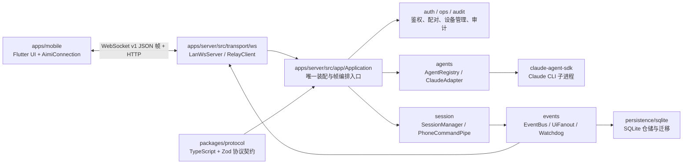

# Aimi 开发指南

## 1. 项目概述

Aimi 是一个由 Flutter 移动端、Node.js/TypeScript 服务端和协议包组成的远程 agent 会话监控与控制项目。
服务端在本机托管 agent CLI 子进程（经 `@anthropic-ai/claude-agent-sdk` 驱动 Claude CLI），负责会话生命周期、事件归一化、鉴权、持久化和 WebSocket 推送。
移动端通过 WebSocket 查看会话时间线并发送建会话、消息和中断命令；同一端口还承载 APK 检查更新下载与意见反馈上传的 HTTP 面。
技术栈为 Node.js 22、TypeScript、pnpm workspace、Zod、Vitest、SQLite（better-sqlite3）、Flutter/Dart 和 Riverpod。
当前仓库包含 `apps/server`、`packages/protocol` 与 `apps/mobile`；没有独立的 relay 服务，relay 是服务端的一个出站客户端。

## 2. 项目架构



- `apps/server/src/app/Application` 是组合根和会话协议编排点：启动时装配 SQLite 仓储、鉴权、agent、事件总线、会话管理器和 WebSocket；关闭时按逆序释放资源。同一监听端口的非升级 HTTP 请求经 `onRequest` 单槽分发：`POST /feedback` 归反馈通道，`GET /updates/*` 与 `POST /internal/updates/refresh` 归更新发布面。
- `transport/ws` 只负责 WebSocket 接入/中继连接和原始帧搬运；业务帧由 `Application` 解析后分派到 `auth`、`session` 或 `ops`。
- `session/SessionManager` 管理会话状态、命令入口、启动恢复和进程台账；`PhoneCommandPipe` 处理手机命令去重及投递。
- `agents/AgentRegistry` 选择适配器并维护协议探测失败后的标灰状态；`agents/claude/ClaudeAdapter`/`ClaudeSession` 基于 `@anthropic-ai/claude-agent-sdk` 的 `query()`：SDK 负责拉起/终止 Claude CLI 子进程和 stream-json 双向协议，适配器只做生命周期编排与事件归一化；审批经 SDK `canUseTool` 进程内回调桥到手机，不再手搓 stdin 线协议。
- `events/EventBus` 为事件序号和发布顺序的中心；持久化订阅写入 SQLite，`UiFanout` 将事件推给已鉴权的连接，`SessionWatchdog` 只做停滞观测。
- `packages/protocol` 提供服务端使用的 TypeScript 类型、帧解析和 Zod 校验；移动端在 `apps/mobile/lib/data/protocol/frame_dto.dart` 维护对应 Dart DTO，修改协议时必须同步核对两侧。
- 服务端是单个 Node 进程、单事件循环和异步 I/O；每个 agent 会话经 SDK 产生一个受生命周期管理的 CLI 子进程。`aimi-server` 的 `pair/status/devices/revoke/feedback/publish-apk` 等子命令是独立 CLI 进程，通过 SQLite 与运行中的服务共享状态。
- 默认只监听 loopback 明文 WS；配置非 loopback `host` 时必须同时配置 `tls.certFile`/`tls.keyFile`，服务端原生提供 WSS。WebSocket 入站有 8 MiB 单帧上限、握手缓冲上限和每连接速率限制，慢消费者超过出站缓冲上限会断开并依靠重连重放恢复。
- `ServerConfig.relay` 存在时，服务端经 `relayClient` 主动建立出站 relay WebSocket；relay 连接与 LAN 连接共用 `Application.attachConnection` 编排入口。

## 3. 目录说明

| 路径                                                                                           | 用途                                                                                                                                 |
| ---------------------------------------------------------------------------------------------- | ------------------------------------------------------------------------------------------------------------------------------------ |
| `apps/server/src/bin`                                                                          | `aimi-server` CLI 入口：`start/status/lan-token/pair/devices/revoke/publish-apk/feedback/install/uninstall`。                        |
| `apps/server/src/app`                                                                          | `Application` 组合根、配置加载（Zod 严格校验）、反馈通道与更新发布面、版本信息。                                                     |
| `apps/server/src/transport`                                                                    | LAN WebSocket 服务、relay 出站客户端和消息管道。                                                                                     |
| `apps/server/src/session`                                                                      | 会话状态机、命令分发、看门狗、命令队列、进程回收（processReaper）。                                                                  |
| `apps/server/src/agents`                                                                       | agent 注册表（含标灰状态）；`claude/` 是基于 claude-agent-sdk 的适配器、协议归一化与错误文案。                                       |
| `apps/server/src/events`                                                                       | 事件总线、UI 扇出和事件洪水控制。                                                                                                    |
| `apps/server/src/auth`, `ops`, `audit`, `logging`                                              | 鉴权/配对、运维命令（设备、反馈、发布 APK、Windows 计划任务自启）、审计和日志。                                                      |
| `apps/server/src/persistence`                                                                  | 内存仓储、SQLite 仓储、迁移和 schema。                                                                                               |
| `apps/server/__tests__`                                                                        | 服务端端到端测试（`e2e_*.test.ts`，经 `AIMI_FAKE_CLI_PATH` 假 CLI 注入）；`src/**/*.test.ts` 是模块测试。                            |
| `packages/protocol/src`                                                                        | 服务端共享协议模型、Zod schema 和协议测试（`__tests__/schema.test.ts`）。                                                            |
| `apps/mobile/lib`                                                                              | Flutter 应用：`app` 装配、`data` 连接/协议/缓存/日志/反馈/更新、`domain` 视图模型、`ui` 页面。                                       |
| `apps/mobile/test`                                                                             | Flutter 测试，按 `test/data`、`test/domain`、`test/ui` 分层，另有 `smoke_test.dart`。                                                |
| `docs`                                                                                         | 注释规范（`code-comment-guidelines.md`）、UI 研究资料（`research/`）；`superpowers/` 下的 specs/plans 属于过程文件，不作为实现依据。 |
| `tools`                                                                                        | 仓库检查脚本：`check-deps.mjs`（依赖方向静态检查）。                                                                                 |
| `resources`                                                                                    | 静态资源（icon PNG），供移动端打包引用。                                                                                             |
| `prototypes`                                                                                   | UI 原型（`codex/` 十四屏原型、设计 tokens），不属于生产应用源代码。                                                                  |
| `plugins`                                                                                      | 本机 ZCode 插件（如 `token-speed`），与 Aimi 应用代码无关，不参与 pnpm 构建。                                                        |
| `node_modules/`, `dist/`, `apps/mobile/build/`, `apps/mobile/.dart_tool/`, `apps/server/data/` | 依赖、编译物、Flutter 生成物和本地运行数据；均不应手动修改或提交。                                                                   |

## 4. 文档指引

- [`docs/code-comment-guidelines.md`](docs/code-comment-guidelines.md)：TypeScript 注释的职责边界、JSDoc 和提交前自检；写注释前先读。
- [`design.md`](design.md)：移动端 UI 设计原则与评审基准（克制、状态交给图标与动效、一个主按钮等十一条），改 UI 前对照。
- [`apps/mobile/README.md`](apps/mobile/README.md)：Flutter 工程的基础入口和官方开发资源；内容较为通用。
- [`docs/server-architecture.md`](docs/server-architecture.md)：服务端组合根、帧编排、会话生命周期/分叉、事件与持久化的现状说明。
- [`docs/operations.md`](docs/operations.md)：部署、配置/备份、APK 发布、反馈处理与已知问题排障手册。

## 5. 常用命令

前置条件：Node.js `>=22`，pnpm `9.12.0`；移动端命令需要已安装 Flutter（CI 使用 Flutter `3.41.2`）。pnpm 命令均从仓库根目录执行；Flutter 命令在 `apps/mobile` 工程目录执行。

```powershell
# 安装依赖（严格使用锁文件）
pnpm install --frozen-lockfile

# 依赖方向静态检查
node tools/check-deps.mjs

# TypeScript 类型检查（protocol 与 server workspace）
pnpm typecheck

# 全部 pnpm workspace 测试（protocol + server）
pnpm -r test

# 根脚本定义的 server 测试快捷方式
pnpm test

# server 构建到 apps/server/dist
pnpm --filter @aimi/server build

# server 开发模式（tsx watch；启动默认服务）
pnpm serve

# 运行单个 server 测试文件
pnpm --filter @aimi/server exec vitest run src/app/application.test.ts

# 运行单个 protocol 测试文件
pnpm --filter @aimi/protocol exec vitest run src/__tests__/schema.test.ts

# server CLI 子命令；可追加 --config <path>；CLI 层还会自动发现 ~/.aimi-server/config.yaml
pnpm --filter @aimi/server exec tsx src/bin/aimi-server.ts status
pnpm --filter @aimi/server exec tsx src/bin/aimi-server.ts pair
pnpm --filter @aimi/server exec tsx src/bin/aimi-server.ts devices
pnpm --filter @aimi/server exec tsx src/bin/aimi-server.ts revoke DEVICE_ID
pnpm --filter @aimi/server exec tsx src/bin/aimi-server.ts feedback list
pnpm --filter @aimi/server exec tsx src/bin/aimi-server.ts feedback show FEEDBACK_ID

# 根级快捷脚本：扫码配对、发布 APK（APK 路径为第一个参数；可加 --notes/--version-name/--version-code/--force）
pnpm pair
pnpm publish-apk <apk-path>

# Flutter 依赖、静态分析和全量测试（从 apps/mobile 工程目录执行）
Push-Location apps/mobile
flutter pub get
flutter analyze
flutter test
Pop-Location

# Flutter 单个测试文件
Push-Location apps/mobile
flutter test test/data/connection/aimi_connection_test.dart
Pop-Location
```

- `pnpm serve`、`pair`、`publish-apk`、`install` 等会创建/读取本地数据目录（默认 `~/.aimi-server/`）和令牌；不要把生成的 `apps/server/data` 或日志提交。
- `aimi-server install`/`uninstall` 注册/注销 Windows 计划任务（用户登录自启），仅限 Windows。
- CI（`.github/workflows/ci.yml`）：server 作业在 `windows-latest` 跑 check-deps + typecheck + `pnpm -r test`（子进程用例依赖 Windows 行为）；mobile 作业在 `ubuntu-latest` 跑 `flutter pub get / analyze / test`，Flutter 版本固定 `3.41.2`。
- TODO: 待确认：仓库没有根级 lint/format 脚本；提交前只执行已配置的检查。

## 6. 编码规范

1. 新增的类和函数（包括构造函数、私有方法和测试方法）必须带有清晰的注释，说明职责、行为和必要约束。正例：说明 `SessionManager` 的状态恢复约束；反例：只重复 `start()` 的函数名。
2. 函数体内的行内注释仅在行为不直观、涉及线程边界、协议兼容或资源生命周期时添加，注释说明原因和约束，不重复代码本身的含义。
3. 不允许把代码块压缩到同一行，每行只执行一件事，禁止在同一行连续写多条语句或使用单行复合语句。
4. 保持公共协议、序列化字段、数据链路命令、配置键和本地化键的向后兼容，变更前必须搜索全部调用方、生产者和消费者；尤其要同步核对 `packages/protocol/src` 与 `apps/mobile/lib/data/protocol/frame_dto.dart`。
5. 不要在源码、日志或文档中写入密钥、令牌、服务密码、生产地址或用户数据，配置读取遵循项目已有的配置对象和部署机制。
6. 优先复用已有的工具函数和公共组件，禁止重复实现同等功能，新增通用能力前先搜索现有实现。
7. TypeScript 注释使用简体中文，并遵守 [`docs/code-comment-guidelines.md`](docs/code-comment-guidelines.md)；不要用注释掩盖过期实现。
8. 遵守 `tools/check-deps.mjs` 的依赖方向约束：`transport` 不反向依赖 `session/agents/events/app`，`persistence` 不依赖业务/传输层，协议包不得相对导入 `apps/**`。

## 7. 项目约定

- workspace 范围由根目录 `pnpm-workspace.yaml` 定义为 `packages/*` 和 `apps/*`；新增 TypeScript 包时同步提供 `package.json`、`tsconfig.json` 和必要测试。
- 服务端测试文件使用 `*.test.ts`，端到端测试放在 `apps/server/__tests__`；Flutter 测试使用 `*_test.dart` 并按 `test/data`、`test/domain`、`test/ui` 分层。
- 服务端配置由 `apps/server/src/app/config.ts` 通过 Zod 严格校验；新增配置键必须更新 schema、`ServerConfig`、相关测试和必要文档，未知键不能被静默接受。
- 新增协议帧或字段前，先搜索 TypeScript 生产者/消费者、Dart DTO/解析器和相关测试，保持 `v: 1` 帧的兼容行为；不得只为服务端测试增加临时字段。hello 帧经可选能力声明协商增量行为：`commandAck: true` 启用 `command.ack`、`capabilities.permissionModes` 只影响 welcome 投影；旧客户端缺省时保持旧帧序列。
- 运行时状态变更应经过 `SessionManager`，事件序号和发布顺序由 `EventBus` 统一管理，持久化通过 `persistence` 仓储完成；不要从传输层直接操作 SQLite 或 agent。
- agent 子进程由 SDK 拉起，其创建、停止、恢复线索和孤儿回收由 `agents`、`session` 与 `Application` 协作完成；修改生命周期时必须覆盖正常关闭、异常退出和服务重启场景。服务端测试用 `AIMI_FAKE_CLI_PATH` 环境变量注入假 CLI（桩脚本读取 `src/agents/claude/__fixtures__/` 下的 JSONL 回放），不要在测试里依赖真实 claude CLI。
- 提交历史使用带 scope 的 Conventional Commits，例如 `feat(server): ...`、`fix(mobile): ...`、`chore(mobile): bump version x.y.z+N`；新提交保持同一格式。提交由 husky 钩子强制门禁（pre-commit 格式化/lint/密钥扫描，pre-push typecheck/依赖方向/受影响测试），勿用 `--no-verify` 绕过。
- 提交前至少运行 `node tools/check-deps.mjs`、`pnpm typecheck`、`pnpm -r test`；涉及移动端时再进入 `apps/mobile` 运行 `flutter analyze` 和 `flutter test`（与 CI 一致）。CI 分 push（ci-fast 精简）与 PR（全量+覆盖率+审计）两级，job 定义见 `.github/workflows/ci.yml`，质量体系全景见 `docs/quality.md`。
- 移动端发版走 `pubspec.yaml` 版本号 bump → 构建签名 APK → `pnpm publish-apk <apk-path>`（版本号可从 APK manifest 自动读取；低版本号默认拒绝，`--force` 覆盖），运行中服务会收到刷新通知并推送给在线手机。
- 联调/测试产生的临时资源（模拟器截图、UI dump、临时日志、一次性脚本等）在验证完成后立即清理：能作为验收证据的先移入 `docs/` 或固化为测试断言，其余直接删除，不得长期滞留仓库根目录或进入提交。
- 分支命名与发布流程按 [`docs/operations.md`](docs/operations.md) §7 记录的现行惯例执行；生产部署无独立环境，规范缺口在该文档中以 `TODO: 待确认` 标注。

## 8. agent 行为约束（质量门禁配套；每条尽量对应自动化检查，无法自动化的标注"依赖人工审核"）

1. 开发顺序固定：复述需求 → 先写测试 → 再实现 → 跑全套检查 → 自查清理（`git status --porcelain` 必须为空，hygiene job 校验）→ 按交付模板汇报。测试与实现同一 PR 提交，不得拆出"后续补测试"。
2. 禁止跳过或弱化测试：不得删除/改名/跳过（`skip`/`only`/放宽断言）既有用例来让门禁变绿；不得修改 `tools/coverage-baseline.json` 下调数值（基线只升不降，上调须单独 commit 并说明——CODEOWNERS 强制审核）。违者 CI 棘轮/CR 拦截。
3. 禁止修改门禁配置放行自己：`.github/workflows/`、`tools/`、`.husky/`、eslint/prettier/vitest 配置、`pnpm-lock.yaml` 均在 CODEOWNERS 高风险段；变更时 PR 模板的「门禁变更声明」必填（依赖人工审核）。
4. 禁止 `--no-verify`、`--force` 推送、绕过 hook（依赖人工审核 + 分支保护禁 force）。
5. 禁止无关重构：不借功能之便重命名/移动/重排与需求无关的代码（依赖人工审核）。
6. 禁止编造 API：引用不存在的函数/配置/文档视为严重过失；不确定时先读代码再写（依赖人工审核 + CR 抽查）。
7. 临时产物只进系统临时目录（`mkdtempSync`/`%TEMP%`），验证后即删；不入仓库根目录（hygiene job 黑名单拦截：根目录截图、.env、coverage/、会话工具产物等）。
8. 必须停下来交人工判断的情形：门禁失败且原因不明；需要下调任何阈值/baseline；高风险路径（auth/session/migrate/protocol/bin）的语义变更；PR 模板中无法如实勾选的自查项。
9. 交付汇报必须包含：改动文件清单、检查命令与真实运行输出（不得写"应该通过"）、风险点、`git status --porcelain` 输出。
